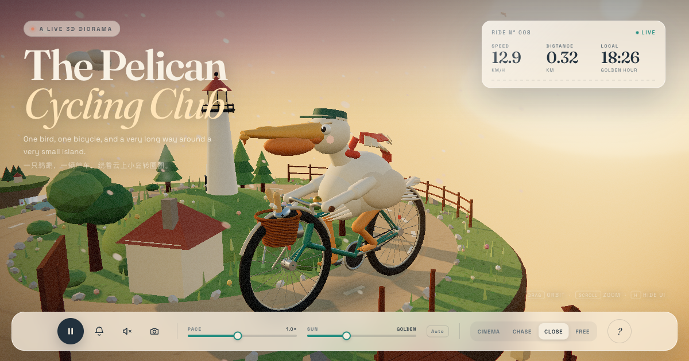

# The Pelican Cycling Club

**One pelican. One bicycle. A very small island in a very large sky.**

A single-file, zero-asset 3D diorama built with Three.js. Everything you see — the bird, the bike, the island, the clouds, the textures, the music — is generated in the browser from code.

**Live:** https://lktoken.github.io/pelican-cycling-club/



## What's inside

- A procedural pelican with a two-bone IK cycling rig, feathered vest, cap, and two windswept scarf tails
- A vintage bicycle: spoked wheels, fenders, chain, wicker basket, baguettes, a fish, a brass bell, and a headlight
- A floating island with a lighthouse, cottage, forest, pond, pier, waterfall, signpost, and a ring road
- Golden hour → sunset → blue hour → night, with glowing windows, a sweeping lighthouse beam, fireflies, stars, and a moon
- Three.js post-processing: bloom, film grain, vignette, and subtle chromatic aberration
- Synthesized ambient audio and bell, no audio files
- A live HUD, cinematic follow-orbit, chase/close/free cameras, pace and time controls, and postcard PNG export
- Responsive layout with a rider-first camera on portrait screens
- Graceful reduced-motion and WebGL failure handling

## Controls

| Input | Action |
| --- | --- |
| Drag / scroll | Orbit / zoom |
| `Space` | Pause or resume |
| `1` `2` `3` `4` | Cinema, Chase, Close, Free camera |
| `B` | Ring the bell |
| `N` | Toggle golden hour / night |
| `M` | Sound on / off |
| `P` | Save a postcard |
| `H` | Hide/show the interface |

## Run locally

No build step. Serve the folder with any static server:

```bash
python3 -m http.server 4173
# open http://127.0.0.1:4173/
```

Requires a WebGL-capable browser and network access to `cdn.jsdelivr.net` (Three.js) and Google Fonts.

## Notes

- Three.js is pinned to `0.170.0` and loaded via an import map from jsDelivr.
- All textures are drawn to `<canvas>` at runtime: grass, road, rock, wood, wicker, feathers, stars, petals, smoke, moon, signage.
- The scene is intentionally a little theatrical. The pelican is not to scale.

---

Made as a small love letter to slow rides and very large skies.
